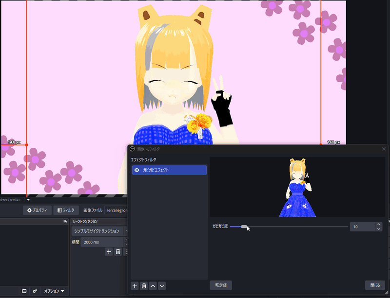

# ガビガビエフェクト / Image Degradation

OBS Studio 向けの、ネットで転載を重ねた画像のように映像をガビガビに劣化させる映像フィルターのプラグインです。

A video filter plugin for OBS Studio that degrades the image like a picture that has been reposted and recompressed over and over on the internet.

[配信プラグイン倉庫くん](https://soko-kun.allegromoltov.jp/plugins/allegromoltov/image-degradation) にも掲載しています。 / Also listed on [Plugin Soko-kun](https://soko-kun.allegromoltov.jp/plugins/allegromoltov/image-degradation?lang=en).



## 通信とデータ / Network and data

このプラグインはネットワークへ何も送信しません。映像はプラグインの中で GPU が処理し、外部のファイルやサービスを使いません。

This plugin sends nothing over the network. The GPU processes the image inside the plugin, and no external files or services are used.

## Features / 機能

ソースやグループに付ける映像フィルターです。設定はガビガビ度のスライダー 1 本だけです。0 では元の映像のまま、上げるほど次の劣化が同時に強まります。

- JPEG の圧縮のような 8×8 のブロックと、輪郭の周りのノイズ
- 解像度を下げてから補間で戻すことによるぼけ
- 色のずれ (赤と青が左右にずれる)
- シャープの縁取り
- 彩度とコントラストの持ち上げ

ガビガビ度は対数の曲線で効かせ、低い範囲ほど変化が大きくなるようにしています。どの要素も見た目を近づけた軽い近似で、描画はすべて GPU のシェーダーで行います。1920×1080 の 1 フレームあたりの GPU 時間は、ガビガビ度 1〜16 で約 0.6 ms、17〜100 で約 0.1〜0.2 ms です (RTX 3060 Ti、Direct3D 11 で測定)。

A video filter for sources and groups with a single "Degradation" slider. At 0 the image passes through unchanged. Raising it strengthens all of the following at once.

- 8×8 blocks and ringing around edges, as in JPEG compression
- Blur from reducing the resolution and scaling it back up
- Color shift (red and blue move to the left and right)
- Sharpening halos
- Boosted saturation and contrast

The slider follows a logarithmic curve, so it changes the most at the low end. Every step is a lightweight approximation of the look, and all drawing runs in GPU shaders. GPU time per 1920×1080 frame is about 0.6 ms at 1–16 and about 0.1–0.2 ms at 17–100, measured on an RTX 3060 Ti with Direct3D 11.

## Installation / インストール

### Windows

Windows 版は OBS Studio 33 以降向けです。

#### 通常版 OBS への導入

プラグインを OBS Studio の共通プラグインフォルダー `C:\ProgramData\obs-studio\plugins` へ配置します。

1. OBS Studio を終了してください。
2. [Releases](../../releases) から `image-degradation-<version>-windows-x64.zip` をダウンロードし、展開してください。
3. エクスプローラーのアドレスバーへ `%PROGRAMDATA%` を入力し、Enter キーを押してください。隠しフォルダーの表示設定を変更する必要はありません。
4. `obs-studio` フォルダーを開き、その中の `plugins` フォルダーを開いてください。存在しないフォルダーは順に作成してください。
5. 展開した `image-degradation` フォルダーを `plugins` へコピーしてください。管理者の許可を求められた場合は許可してください。
6. OBS Studio を起動し、ソースのフィルターからガビガビエフェクトを追加してください。

導入後の構成を次に示します。`image-degradation` フォルダーを二重に作らないでください。PDB ファイルが同梱されている場合も、製品フォルダーごとコピーします。

```text
C:\ProgramData\obs-studio\plugins\
└─ image-degradation\
   ├─ image-degradation.dll
   └─ data\
      ├─ effects\image-degradation.effect
      └─ locale\
         ├─ en-US.ini
         └─ ja-JP.ini
```

更新するときは、OBS Studio を終了し、同じ手順で `image-degradation` フォルダーを上書きコピーしてください。設定やシーンは削除しないでください。アンインストールするときは、OBS Studio を終了して `image-degradation` フォルダーを削除してください。

1. Quit OBS Studio.
2. Download `image-degradation-<version>-windows-x64.zip` from [Releases](../../releases) and extract it.
3. Copy the `image-degradation` folder into `C:\ProgramData\obs-studio\plugins`. Create the `obs-studio` and `plugins` folders if they do not exist.
4. Start OBS Studio and add "Image Degradation" from the filters of a source.

To uninstall, quit OBS Studio and delete the `image-degradation` folder.

#### ポータブル版 OBS

ポータブル版では、OBS Studio のルートフォルダーにある `plugins` へ製品フォルダーをコピーします。通常版の `%PROGRAMDATA%` への導入では読み込まれません。

OBS Studio を終了し、`bin` や `data` と同じ階層に `plugins` フォルダーを作成してください。展開した製品フォルダーをコピーし、`plugins\image-degradation\image-degradation.dll` と `plugins\image-degradation\data` を配置してから OBS Studio を起動します。

### Linux (Ubuntu)

Ubuntu 24.04 (x86_64) 向けの `.deb` を Releases に置いています。OBS Studio の公式の PPA (`ppa:obsproject/obs-studio`) から apt で導入した OBS Studio が前提です。Releases から `image-degradation-<version>-x86_64-linux-gnu.deb` をダウンロードし、そのフォルダーで `sudo apt install ./image-degradation-<version>-x86_64-linux-gnu.deb` を実行してください。

Linux 版は、GitHub Actions の Ubuntu 24.04 (Mesa の OpenGL) で描画を自動で検証しています。作者は Linux の実機を持たないため、実機の GPU と OBS Studio では動作を確認していません。

A `.deb` for Ubuntu 24.04 (x86_64) is available on Releases. It requires OBS Studio installed with apt from the official PPA (`ppa:obsproject/obs-studio`). Download `image-degradation-<version>-x86_64-linux-gnu.deb` and run `sudo apt install ./image-degradation-<version>-x86_64-linux-gnu.deb` in that folder.

The Linux build is verified automatically by rendering tests on Ubuntu 24.04 (Mesa OpenGL) in GitHub Actions. The author has no Linux machine, so it has not been tested on real hardware.

### macOS

macOS 版は配布しません。GitHub Actions の macOS 15 (OpenGL) でビルドと描画を検証しているだけです。

There is no macOS release. The build and rendering are only checked on macOS 15 (OpenGL) in GitHub Actions.

## ダウンロードしたファイルの検証 / Verifying downloads

リリースのファイルには、GitHub Actions でビルドしたことを示す build provenance の証明を付けています。[GitHub CLI](https://cli.github.com/) で確かめられます。各ファイルの SHA-256 は、リリースのページの各ファイルの横に表示されます。

Every release file has a build provenance attestation made by GitHub Actions. You can verify it with the [GitHub CLI](https://cli.github.com/). The SHA-256 of each file is shown next to it on the release page.

```
gh attestation verify image-degradation-1.0.0-windows-x64.zip --repo AllegroMoltoV/image-degradation
```

## Usage / 使い方

1. 劣化させたいソースかグループを右クリックし、フィルターを開きます。
2. 映像フィルターの + ボタンから、ガビガビエフェクト (Image Degradation) を追加します。
3. ガビガビ度で崩れ具合を調整します。

1. Right-click the source or group and open Filters.
2. Add Image Degradation with the + button under Effect Filters.
3. Adjust the damage with the Degradation slider.

## Parameters / パラメータ

| Parameter | 日本語 | Range | Default |
|-----------|--------|-------|---------|
| Degradation | ガビガビ度 | 0 ~ 100 | 10 |

ガビガビ度に対応する値は次のとおりです。量子化の倍率は JPEG の標準の表に掛ける倍率で、100% が JPEG の品質 50 に当たります。色のずれは元の解像度での px です。

| ガビガビ度 / Degradation | 量子化の倍率 / Quantization | 解像度 / Resolution | 彩度 / Saturation | コントラスト / Contrast | シャープ / Sharpen | 色のずれ / Color shift |
|-----------|-------|-------|-------|-------|-------|-------|
| 0 | 処理しない / off | - | - | - | - | - |
| 1 | 24% | 1/1 | 1.04 | 1.02 | 0.07 | 0 px |
| 10 | 88% | 1/1 | 1.28 | 1.14 | 0.56 | 0 px |
| 30 | 406% | 1/2 | 1.57 | 1.28 | 1.14 | 2 px |
| 50 | 1,011% | 1/3 | 1.74 | 1.37 | 1.48 | 6 px |
| 70 | 1,934% | 1/4 | 1.86 | 1.43 | 1.73 | 8 px |
| 100 | 4,000% | 1/4 | 2.00 | 1.50 | 2.00 | 12 px |

## Known Behavior / 既知の挙動

- ソースに付けると、そのソースの不透明な部分だけが劣化します。透明な部分と、奥にあるほかのソースは元のままです。シーンやグループに付けると、中の項目を重ねた後の絵全体にかかり、奥のソースも劣化します。
- HDR の映像 (Rec. 709 の拡張の色空間) では、OBS Studio の標準のシャープフィルターと同じく、劣化をかけずにそのまま通します。
- 色差は 2×2 の画素で同じ値を使います。そのため、色の境界がブロック状ににじみます。
- 半透明の画素は、色をアルファで割り戻してから劣化させます。アルファは元のまま残します。
- 実際の JPEG のファイルの読み書きはしません。見た目を近づけた近似のため、JPEG で保存した画像と画素の値は一致しません。

- On a source, only its opaque parts are damaged. Transparent parts and other sources behind it stay unchanged. On a scene or group, the filter applies to the whole picture after its items are composited, so sources behind are damaged too.
- HDR images (extended Rec. 709 color space) pass through unchanged, as with the built-in Sharpen filter of OBS Studio.
- Chroma uses one value per 2×2 pixels, so color edges bleed in blocks.
- Translucent pixels are damaged after their color is divided by alpha. Alpha itself is kept unchanged.
- No real JPEG file is written or read. The look is approximated, so pixel values do not match a saved JPEG.

## Build / ビルド

### Requirements / 必要環境

| Platform | Tool |
|----------|------|
| Windows | Visual Studio 17 2022, CMake 3.28+ |
| macOS | Xcode 16.0, CMake 3.28+ |
| Ubuntu 24.04 | ninja-build, pkg-config, build-essential, CMake 3.28+ |

### Build Commands / ビルドコマンド

```bash
# Windows
cmake --preset windows-x64 -DENABLE_POST_BUILD_INSTALL=OFF
cmake --build build_x64 --config RelWithDebInfo

# macOS
cmake --preset macos
cmake --build build_macos --config RelWithDebInfo

# Ubuntu
cmake --preset ubuntu-x86_64
cmake --build build_x86_64 --config RelWithDebInfo
```

Windows で生成物を取り出すには、`cmake --install build_x64 --config RelWithDebInfo --prefix release/RelWithDebInfo` を実行してください。生成した製品フォルダーを前述の手順で導入してください。

Windows では、描画の統合テストを Direct3D 11 と OpenGL の両方で CTest に登録しています。統合テストは、libobs にプラグインを読み込んでフィルターを付け、出力の画素を CPU で同じ計算をした参照の値と比べます。OBS のグラフィックスの DLL を `cmake --build .deps/obs-studio-31.1.1/build_x64 --config Release --target libobs-d3d11 libobs-opengl` で作ってから、`ctest --test-dir build_x64 -C RelWithDebInfo` を実行してください。CI では同じテストを Windows (Direct3D 11)・Ubuntu・macOS (OpenGL) で実行します。

On Windows, rendering tests for Direct3D 11 and OpenGL are registered with CTest. They load the plugin into libobs, add the filter, and compare the output pixels with a CPU reference that does the same math. Build the OBS graphics DLLs with `cmake --build .deps/obs-studio-31.1.1/build_x64 --config Release --target libobs-d3d11 libobs-opengl`, then run `ctest --test-dir build_x64 -C RelWithDebInfo`. CI runs the same tests on Windows (Direct3D 11), Ubuntu, and macOS (OpenGL).

## AI利用開示 / AI Disclosure

### 日本語

v1.0.0 の制作では、Anthropic Claude Code を、調査、ソースコード、ビルド設定、テスト、文書を含むほぼすべての工程で使用しました。リソースアイコンは、Claude Code が作成したスクリプトで生成した SVG の案から、作者本人が選びました。

作者本人は Windows 上の OBS Studio でユーザーテストを実施しました。コード読解による厳密な人間レビューは実施していません。概要説明欄のアニメーション GIF は、作者本人が ScreenToGif で画面収録したもので、生成 AI を使用していません。容量の上限に収めるための縮小は、Claude Code が ffmpeg で行いました。

### English

Anthropic Claude Code was used for almost the entire development process of v1.0.0, including research, source code, build configuration, tests, and documentation. The resource icon was chosen by the author from SVG candidates generated by a script that Claude Code wrote.

The author performed user testing in OBS Studio on Windows but did not perform a rigorous human review of the source code. The animated GIF in the description was screen-recorded by the author using ScreenToGif, without generative AI. Claude Code resized it with ffmpeg to fit the size limit.

## License / ライセンス

GPL-2.0 License

このプラグインは [obs-plugintemplate](https://github.com/obsproject/obs-plugintemplate) をベースにしています。

This plugin is based on [obs-plugintemplate](https://github.com/obsproject/obs-plugintemplate).

## Author / 作者

AllegroMoltoV - https://www.allegromoltov.jp

## Changelog / 更新情報

### v1.0.0 (2026-11-16)

- 最初の公開版です。 / First public release.
